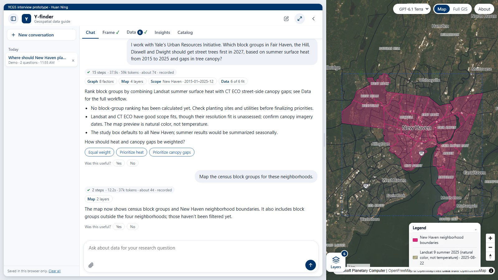
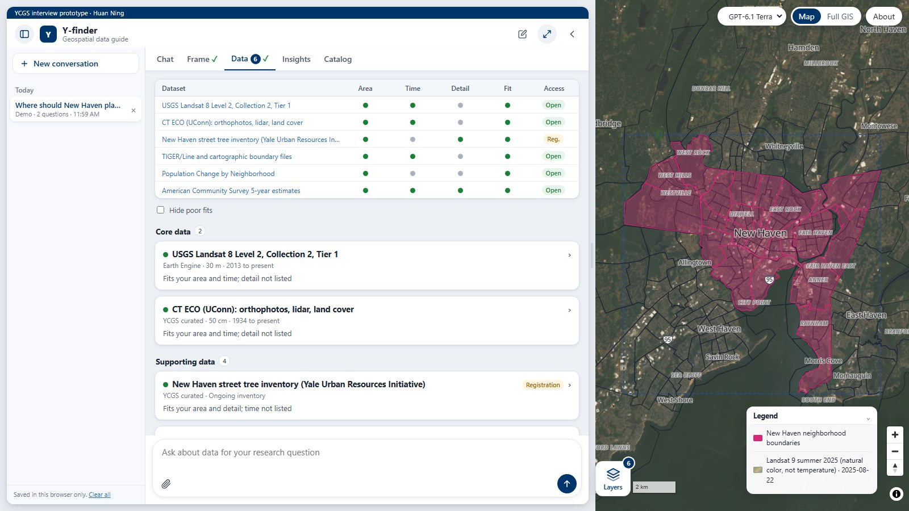

# Y-finder

**A conversational geospatial data guide.** Describe a research question. Y-finder maps the factors behind it, agrees a study scope with you, finds datasets, tools and methods, and labels how well each one fits that scope.

- **Try it:** https://researcharchitect.ai/y (opens https://app.researcharchitect.ai/y-finder/). Start with one of the recorded Yale demo cases, or ask your own question.
- **Design notes:** https://app.researcharchitect.ai/y-finder/design explains how it was built and tested, what a consult costs, and what YCGS would need to run it.
- **Decision log:** [handoff.md](handoff.md) lists every decision in order, with what was done.



Y-finder is an independent prototype by [Huan Ning](https://www.huanning.me/), prepared for the Yale Center for Geospatial Solutions (YCGS). It is not an official Yale or YCGS service. It extends [LLM-Find](https://github.com/gladcolor/llm-find) and follows the tri-projection of [Research Architect](https://app.researcharchitect.ai/): real world, influence graph, scope, data.

## A consult in four steps

1. **Frame.** The agent turns the question into an influence graph: the outcome, the factors that drive, mediate or confound it, and something measurable for each.
2. **Scope.** Place, years, the detail needed and the unit of analysis. Defaults are marked and can be edited; every fit label is recomputed at once, without a model call.
3. **Data.** Catalog and live searches, maps and tables. Rules, not the model, label each dataset for area, time, detail and access.
4. **Review.** Previews on the map, findings computed from them, and one data guide to print or send.



## What it does

- **Tri-projection:** real world -> influence graph -> scope -> data. Shown as a graph, an editable scope card and check marks on the tabs.
- **Honest fit labels:** every dataset is checked by rules (not by the AI) for area, time window, detail and access, with plain reasons. Example: 10 m satellite imagery is a poor fit for small mosquito habitats.
- **Real catalogs:** about 3,100 cards (YCGS curated cards with Yale access routes, Microsoft Planetary Computer, Google Earth Engine and its community catalog, the layers collected in GeoLibre, World Bank indicators) plus live search of Yale and Harvard Dataverse, Yale Library GeoBlacklight, ArcGIS Online, Data.gov, US open data portals (Socrata, including Connecticut Open Data), Planetary Computer STAC and the web (DeepSeek Search and Fetch).
- **Maps and tables:** factors measured by statistics, surveys or records get tables, marked with a Table badge; tables with place codes or town names are joined to boundaries.
- **Previews:** every recommended dataset is drawn from its online service, or a small slice for the study area is downloaded (up to 100 MB, kept for the session only) and shown on the map or as a table preview with a trend line and CSV. Sources that need a person to download are tried by Y-finder's own headless browser, which never signs in, fills forms, accepts terms or passes robot checks.
- **Insights while you look:** once previews are on the map, Y-finder explores them in the background, following the graph: the outcome's data first (spread, highest and lowest places, clustering by Moran's I; for points, where they concentrate, which records match the question, and whether the preview is an even sample over time), then each link into the outcome where both ends have data (Spearman rank correlation after a map join), then the other core factors. Findings appear one by one in the Insights tab with a small chart and Show on map; tested links are labelled in the graph; the AI model reads the findings against the question at the end. Pause and Stop sit on the map and in the tab.
- **Map first:** study area, imagery previews, OpenStreetMap features, Census boundaries and dataset coverage on a Google-Maps-like map with a legend; open the same layers in GeoLibre for full GIS.
- **Access handbooks:** Agent-Skill style `SKILL.md` per source (endpoint, Python example, pitfalls), exportable to LLM-Find's TOML handbooks.
- **People in the loop:** quick replies, scope editing, consultation summary for YCGS staff, opt-in follow-up searches.
- **The data guide:** *Download guide* on the Data tab makes one document (scope, factors and their coverage, every dataset with its fit, access and limits, methods, next steps, what the previews showed, sources read) to print, save as a PDF or copy as Markdown.
- **Cost and feedback:** every answer shows its time, tokens and an estimated cost at the model's list prices (`config.PRICES`, override with `YFINDER_PRICES`); a Yes or No under each answer goes to `runtime/feedback/feedback.jsonl` with the question's first 300 characters only.
- **Demo cases:** 32 cases grounded in real YCGS projects and Yale programs (Urban Resources Initiative, New Haven Digital Atlas, Map of Life, the Humanitarian Research Lab, the Grammatical Diversity Project, the Economic Growth Center, the Peabody herbarium, the Dura-Europos archive and more) and six general ones, recorded from real runs and continued live. The welcome screen shows six; the rest are grouped by theme with a search box. The people in them are fictional; the programs and sources are real.

## What keeps it honest

- Every recommended dataset must come from a search result in the same conversation. Anything else is marked "Not verified" and does not count as coverage.
- Fit labels come from metadata and rules in `yfinder/fit.py`. The model never grades a dataset.
- Web links are opened once; dead links are flagged and the model is told to replace them.
- A preview shows the variable the question asks for, and says when a measure is a stand-in or a sample is uneven over time.
- Findings are computed by code (`yfinder/explore.py`). The model only picks matching categories, checked against the real values, and writes a short reading of the computed numbers.

## Evidence

| What | Result | Where |
|---|---|---|
| Unit and API tests, no model calls | 298 pass | `tests/` |
| Injected faults ("test the tests") | 29 of 29 caught | `scripts/mutation_check.py` |
| Demo cases from real Yale programs | 38 cases, each recording read and its previews and findings inspected; every check passes | `docs/demo_case_results.md`, `docs/demo_batch3_review.md`, `docs/demo_data_audit.md` |
| Fictional YCGS users (10 personas) | 190 of 195 checks across three models in the first run; 64 of 64 on the default model after the fixes | `docs/persona_results.md` |
| Independent code review (Codex CLI) | 15 findings, all fixed with regression tests | `handoff.md` |
| The page in a real browser | welcome, a demo replay, votes, the data guide, a reload, a phone screen | `scripts/ui_smoke.py` |

## Run locally

```bash
pip install -r requirements.txt
# put your OpenAI key in OpenAI_key.txt (git-ignored) or set OPENAI_API_KEY;
# optional: a DeepSeek key in Deepseek_key.txt or DEEPSEEK_API_KEY for web search (else OpenAI's web search)
python -m yfinder.app            # http://127.0.0.1:8770
```

Models: GPT-6.1 Terra (default), GPT-6.1 Sol, GPT-6 Luna (picker in the top bar). The recorded demo cases replay without a key.

## Project layout

```
yfinder/        app.py (Flask API), agent.py (prompt, tools, loop), catalog.py (search), fit.py (scope-fit rules),
                sources.py (live connectors), session.py, handbooks.py, watch.py, personas.py (evaluation),
                previews.py (map previews), tables.py (table joins), downloads.py, janitor.py, websearch.py, geolibre.py,
                browser.py (Y-finder's own browser), explore.py (exploring the previews)
yfinder/data/   curated.json, catalog.json (built), demo_cases.json
static/         index.html, app.css, app.js, design.html (design notes), demos/ (recorded demo cases)
handbooks/      <source>/SKILL.md access handbooks
scripts/        build_catalog.py, write_handbooks.py, record_demos.py, run_personas.py, mutation_check.py, run_watches.py,
                ui_smoke.py
tests/          pytest suite, personas.json
deploy/         systemd units, nginx snippet, deploy.sh
docs/           design.md, literature_review.md, persona_results.md, demo_case_results.md, demo_data_audit.md, demo_batch3_review.md
```

## Tests

```bash
python -m pytest -q                    # unit, API and demo-file tests (no model calls)
python scripts/mutation_check.py       # tests the tests: every injected fault must be caught
python scripts/ui_smoke.py             # the page in headless Chromium (needs: python -m playwright install chromium)
python scripts/run_personas.py         # live: 10 fictional users x 3 models -> docs/persona_results.md
python scripts/record_demos.py         # live: re-record demo cases, scored by their checks
```

## How it was built

Huan Ning designed Y-finder and directed AI coding agents through each decision in [handoff.md](handoff.md): Claude Code wrote most of the code, and Codex CLI gave an independent review. Every demo recording was read in full before it was kept, its previews and findings were inspected, and problems were fixed in Y-finder, not in the demo. The mutation check confirms that the tests catch each injected fault.

See `handoff.md` for deployment, decisions and next steps, and `docs/design.md` for the first design.
